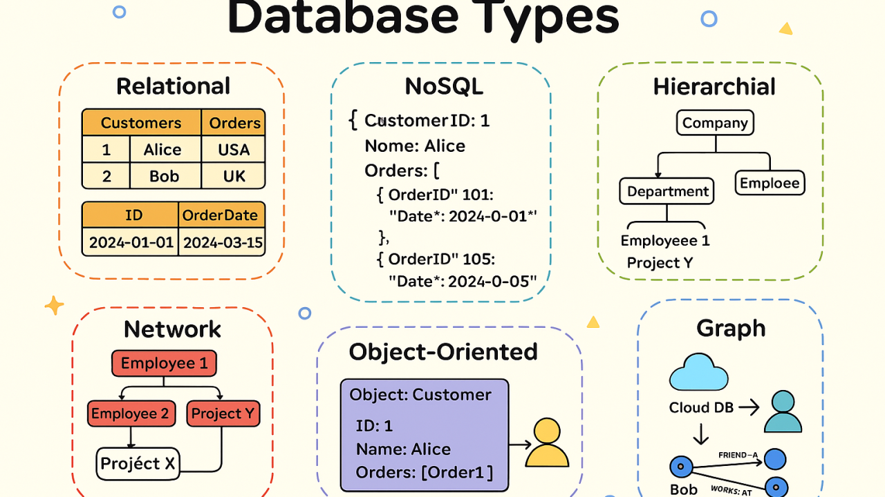
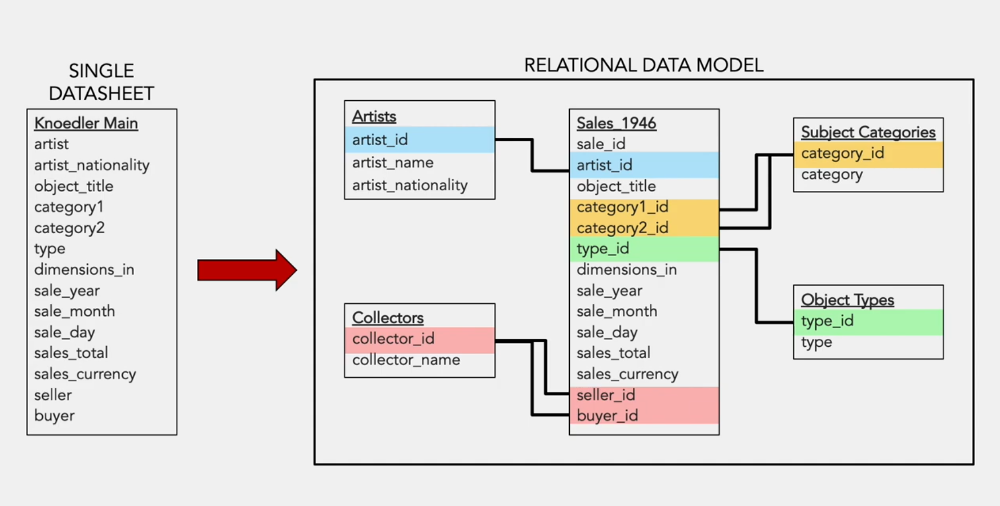

# Humanitats Digitals

	Bases de dades.
	Tipologies, usos i modelització d'una base de dades

---

## Què és una base de dades (BDD)

Una col·lecció de dades
- coherent i estructurada
  - les dades estan descrites i endreçades seguint una lògica
- emmagatzemada
  - no sempre en format digital
- consultable / recuperable
  - gestionada per un sistema que permet accedir fàcilment a les dades

Més info: [What is a Database?](https://www.oracle.com/database/what-is-database/)

----

### Dit d'una altra manera

Una base de dades és una representació d'una parcel·la de la realitat que ens interessa.

Important: no confondre
- "Base de dades": la col·lecció de dades
- "Gestor de bases de dades": l'eina que permet emmagatzemar, organitzar i gestionar la base de dades

----

### Una BDD no es fa *perquè sí*

- Tota BDD té una raó de ser: hi ha un propòsit
  - que explica la seva estructura (el model de dades)
  - que implica una sèrie de decisions que no són neutres

---

## Una mica d'història

Tot va començar amb les targetes perforades i les cintes magnètiques

Font: [IBM](https://assets.ibm.com/is/image/ibm/system360m50_B27_F3:4x3?dpr=on%2C1&fit=fit%2C1&wid=1536&hei=1152); Vídeo: [History of databases](https://www.youtube.com/watch?v=KG-mqHoXOXY)

---

## Conceptes fonamentals sobre BDD

- Entitats i instàncies
- Taules
- Registres
- Atributs i valors; valor nul (*null value*)
- Domini
- Formularis (*forms*)
- Cerques (*queries*)
- Informes (*reports*)
- Taulers de control (*dashboards*)

---

## Tipus (o paradigmes) de bases de dades

Font: [Types of Databases](https://www.linkedin.com/pulse/types-databases-complete-guide-illustrations-bharath-mashetty-damtf)

----

### Bases de dades planes (1)

També anomenades *flat files* o *spreadsheet data*
- cada fila és un *registre*
  - a vegades anomenat *tupla*
  - independent de la resta de registres
- cada columna és un *atribut* del registre
- la cel·la a la intersecció d'una fila i columna és un *camp*
  - i hi ha el *valor* de l'atribut

----

### Bases de dades planes (2)

Són les més senzilles, normalment en text pla (`*.csv`, `*.tsv`)
- lleugeres, ràpides de llegir
- funcionalitat limitada: *queries* poc complexes
- risc de redundàncies i inconsistències
- no hi pot haver concurrència d'usuaris

Exemples?

----

### Bases de dades jeràrquiques

Les dades mantenen una relació jeràrquica
- es pot expressar com un arbre
  - relacions pare-fill
    - un fill només pot tenir un pare
    - un pare pot tenir molts fills
  - navegació de branca en branca fins a la fulla desitjada
    - *queries* molt ràpides
    - alta dependència del vincle pare-fill

Exemples?

----

### Bases de dades relacionals: l'origen

Tot va canviar amb [un article](https://www.engineering.upenn.edu/~zives/03f/cis550/codd.pdf) (1970) d'Edgar F. Codd

Fair use, IBM · [Wikimedia Commons](https://en.wikipedia.org/wiki/File:Edgar_F_Codd.jpg)

----

### Bases de dades relacionals

Un dels paradigmes més utilitzats
- diverses taules amb diversos tipus d'informació (*entitats*)
  - connectades entre elles mitjançant identificadors (*claus*)
- s'eviten redundàncies
- la integritat de les dades és fàcil de preservar
- *queries* molt potents: es pot extreure dades de diverses taules alhora (SQL)
- cal pensar bé el seu disseny

Exemples?

----

#### Recursos sobre BDD relacionals

- Microsoft: [Introduction to tables](https://support.microsoft.com/en-us/access/introduction-to-tables)
- Microsoft: [Database design basics](https://support.microsoft.com/en-us/access/database-design-basics)
- Baserow: [Understanding Relational Databases Made Simple](https://baserow.io/blog/understanding-relational-database)
- Microsoft Ignite: [Explore fundamental relational data concepts](https://learn.microsoft.com/en-us/training/modules/explore-relational-data-offerings/)

----

#### Un exemple en forma gràfica: una taula

	

Font: [What is a relational database?](https://teachcomputerscience.com/relational-database/)

----

#### Un exemple en forma gràfica: una BDD

	

Font: [What is a relational database?](https://teachcomputerscience.com/relational-database/)

----

#### SQL ("sequel" / "ess-quiu-el")

El llenguatge per fer consultes i intervenir sobre BDD relacionals
- és un estàndard, però hi ha versions
- sintaxi (relativament) senzilla
  - paraules clau: `SELECT`, `WHERE`, `SELECT DISTINCT`, `UPDATE`, `DELETE`, etc.
  - operadors: `AND`, `OR`, `NOT`, `ORDER BY`, etc.
  - `;` al final de cada declaració (important!)

Provem-ho [aquí](https://www.w3schools.com/sql/)

----

### Bases de dades no relacionals

També anomenades *noSQL*
- pensades sobretot 
  - per a dades semiestructurades o no estructurades
  - per a datasets molt grans i complexos
- no funcionen realment amb taules
- molts tipus; destaquen
  - grafs
  - dipòsits clau-valor
  - BDD tipus *ledger*

---

## Provem-ho: d'una BDD plana a una BDD relacional

----

### Construim una BDD plana

- Visitem el [Fons Ricard Viñes](https://fonsespecials.udl.cat/handle/10459.2/1684) del repositori institucional de la UdL
- Prenem un [programa de concert](https://fonsespecials.udl.cat/handle/10459.2/1917) (per exemple, [aquest](http://hdl.handle.net/10459.2/1933) o [aquest](http://hdl.handle.net/10459.2/1998))
- En fem el model de dades en forma de taula

----

### La transformem en un model relacional

- Quines *entitats* hi ha?
- Quins *atributs* té cada entitat?
- Quin atribut serà la *clau primària* de cada taula?
- Com connectarem les taules entre elles? Què serà la *clau forana*?

----

### D'una BDD plana a una BDD relacional amb Excel (1)

CV > recursos > 05 bases de dades > `vendes_Knoedler_1946.xlsx`

Utilitzarem dues funcions d'Excel:
- `=ÚNICS` (sí, amb accent)
- `=XLOOKUP`

----

### D'una BDD plana a una BDD relacional amb Excel (2)

Font: [Kaylee Alexander - normalizing Excel spreadsheets](https://www.youtube.com/watch?v=enM3BEOA77s)

---

## Pensem una mica

- Quins avantatges comporta estructurar la informació en taules relacionades respecte a tenir-la en una taula immensa?
- Com es tradueix això al context d'un museu?