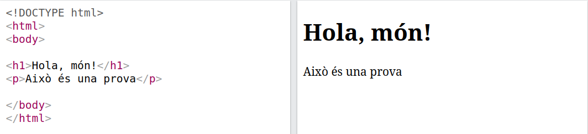
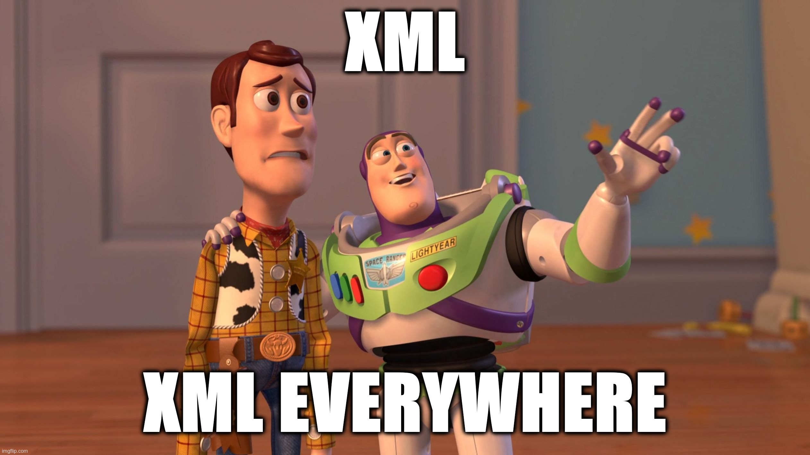
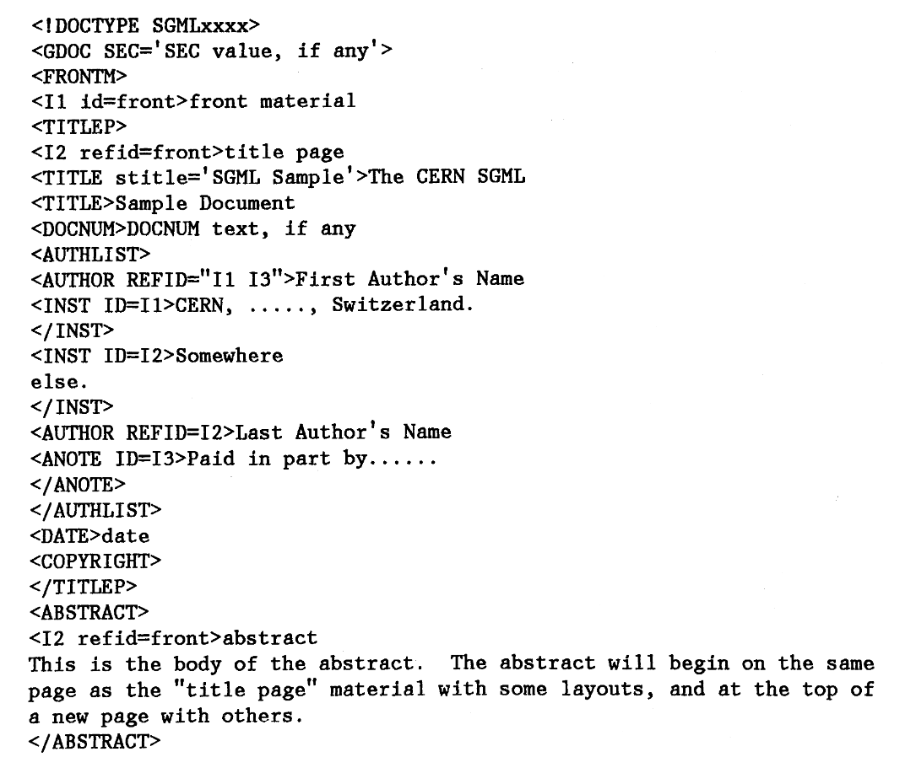
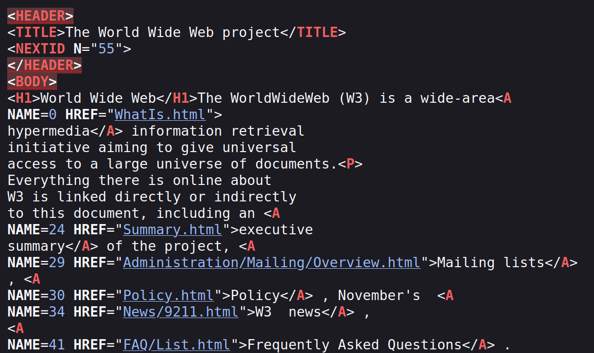

# Humanitats Digitals
<div class="centered">
	<p>Llenguatges de marques i codificació de textos. Introducció a HTML, XML i Markdown</p>
</div>

---

## Els llenguatges informàtics

- Llenguatges per comunicar-se amb un ordinador
- Poden ser de programació
- I d'altres tipus


<span style="font-size: 0.3em;">Font: [XKCD 2309](https://xkcd.com/2309/)</span>

---

## Els llenguatges de marques (*markup languages*)

- Una altra mena de llenguatge informàtic
- Per a *codificar* textos
  - Per a que els ordinadors puguin *processar-los*
  - processar ≠ entendre

----

### Què és un llenguatge de marques? (1)

Llenguatge informàtic, però no de programació
- *tags* que s'afegeixen a textos plans
  - per fer explícit allò conjectural o implícit
    - aparença
    - estructura (metadades!)
    - etc.
  - clarament diferents del text que es codifica
    - cada llenguatge ho fa a la seva manera

----

### Què és un llenguatge de marques? (2)

Cada llenguatge de marques té unes etiquetes i unes normes
- pensat per a textos; pot contenir dades molt diferents

No calen eines especials: només cal un editor de text
  - un text marcat (codificat) és un text estructurat i, per tant, *machine-readable* (processable)

----

#### Editors de text

N'hi ha milers. Cada sistema operatiu n'acostuma a tenir un per defecte (bloc de notes, TextEdit, geany, gedit, xed, etc.)
- però també n'hi ha de més treballats: [notepad++](https://notepad-plus-plus.org/), [Sublime Text](https://www.sublimetext.com/), [Kate](https://kate-editor.org/ca/), [Vim](https://www.vim.org/), [Emacs](https://www.gnu.org/software/emacs/), [Visual Studio Code](https://code.visualstudio.com/), [Bluefish](https://bluefish.openoffice.nl/)...

----

#### Un exemple de text marcat / codificat (1)

```xml
<llibre>
    <autor>
        <cognom>Pena</cognom>
        <nom>Pere</nom>
    </autor>
    <títol idioma="català" mostra="cursiva">Sota la pell, un arbre</títol>
    <dades_edicio>
        <ciutat coordenades="41.6179, 0.6159">Lleida</ciutat>
        <editorial>Eclecta</editorial>
        <any>2026</any>
    </dades_edicio>
</llibre>
```

----

#### Un exemple de text marcat / codificat (2)

<div style="width:90%; text-align:center;">
    <pre><code>
&lt;svg xmlns="http://www.w3.org/2000/svg"&gt;
  &lt;rect width="100" height="80" x="0" y="70" fill="green"/&gt;
  &lt;line x1="5" y1="5" x2="250" y2="95" stroke="red" /&gt;
  &lt;circle cx="90" cy="80" r="50" fill="blue" /&gt;
  &lt;text x="180" y="60"&gt;Un text&lt;/text&gt;
&lt;/svg&gt;
    </code></pre>
  </div>

---

### Tipus de llenguatges de marques

Segons el seu objectiu principal poden ser:
- Presentacionals
- Procedimentals
- Descriptius

----

#### Llenguatges de marques presentacionals

- Especifiquen l'aparença del text
- L'exemple clàssic és `HTML`




----

#### Llenguatges de marques procedimentals

- Indiquen les instruccions que ha de seguir un intèrpret per processar el contingut
- Un exemple: `LaTeX` ("leitek")


<span style="font-size: 0.3em;">Font: [The Data Intelligence Blog](https://data-mining.philippe-fournier-viger.com/using-latex-for-writing-research-papers/)</span>

----

#### Llenguatges de marques descriptius (o semàntics)

- Utilitzen etiquetes per descriure el text que es codifica (estructura, etc.)
  - i per codificar informació *sobre* el text codificat (metadades!)
- Ignoren completament l'aparença del text



<span style="font-size: 0.3em;">Font: [imgflip](https://imgflip.com/i/1m5efq)</span>

----

#### El paradigma OHCO

*Ordered Hierarchy of Content Objects*
- un text és una jerarquia ordenada d'objectes que tenen contingut
- cada objecte s'assenyala amb etiquetes
- un objecte pot estar dins d'un altre
  - si hi està, no pot ser-hi a mitges ("nines russes")

<span style="font-size: 0.3em;">Article: Steven DeRose et al, ["What is Text, Really?"](http://web.dfc.unibo.it/buzzetti/IUcorso2006-07/mdidattici/ohco.pdf)</span>

---

## Una mica d'història (1)

- Charles **G**oldfarb, Edward **M**osher i Raymond **L**orie (IBM) desenvolupen GML (*Generalized Markup Language*)
- 1986: SGML (*Standard Generalized Markup Language*)



<span style="font-size: 0.3em;">Font: [Anders Berglund, CERN SGML User's Guide](https://cds.cern.ch/record/997909/files/cer-002659963.pdf)</span>

----

## Una mica d'història (2)

1989: Tim Berners-Lee es basa en l'SGML implementat per Anders Berglund al CERN i l'any 1991 desenvolupa HTML (*HyperText Markup Language*)
- Diversos estàndards fins 2014 (HTML 5)



<div style="font-size: 0.3em; text-align: left;">
  Font:
  <ul style="margin: 0; padding-left: 1.2em;">
    <li><a href="https://info.cern.ch/hypertext/WWW/TheProject.html">World Wide Web (CERN)</a></li>
  </ul>
  Recursos:
  <ul style="margin: 0; padding-left: 1.2em;">
    <li><a href="https://tovari.fi/how-did-html-1-0-look-like/">Tovari: How Did HTML 1.0 Look Like</a>; <a href="https://status-code.medium.com/the-evolution-of-html-from-html-1-0-to-modern-html5-cadfad8e3d3d">The evolution of HTML: from HTML 1.0 to modern HTML5</a></li>
  </ul>
</div>

----

## Una mica d'història (3)

1997: el W3Consortium va definir l'XML (*eXtensible Markup Language*)

```xml
<?xml version="1.0"?>
<catalog>
   <book id="bk101">
      <author>Gambardella, Matthew</author>
      <title>XML Developer's Guide</title>
      <genre>Computer</genre>
      <price>44.95</price>
      <publish_date>2000-10-01</publish_date>
      <description>An in-depth look at creating applications 
      with XML.</description>
   </book>
   <book id="bk102">
      <author>Ralls, Kim</author>
      <title>Midnight Rain</title>
      <genre>Fantasy</genre>
      <price>5.95</price>
      <publish_date>2000-12-16</publish_date>
      <description>A former architect battles corporate zombies, 
      an evil sorceress, and her own childhood to become queen 
      of the world.</description>
   </book>
</catalog>
```

---

## HTML

Llenguatge de marques per codificar documents que es renderitzaran i utilitzaran a la web
- Descriptiu, identifica elements estructurals (paràgrafs, encapçalaments...)
  - No s'ocupa del seu significat o contingut
- Tot l'aparell visual es gestiona amb fulls d'estil CSS (*Cascading Style Sheets*)
- L'experiència d'usuari és (normalment) cosa de Javascript

Recurs: [Tutorial HTML](https://www.w3schools.com/html/default.asp) a W3CSchools

Guia al CV > recursos > 06 llenguatges de marques

----

### HTML: sintaxi bàsica (provem-ho)

- `<`etiqueta`>`
  - tota etiqueta que s'obre s'ha de `</`tancar`>`
  - una etiqueta pot tenir atributs i valors `<etiqueta atribut="valor">`
- `<!DOCTYPE html>` a la primera línia de qualsevol document HTML
  - *document type declaration*; aquesta etiqueta **no** s'ha de tancar
- resta del document entre `<html>` i `</html>`

```html
<!DOCTYPE html>
<html>
Això és una prova
</html>
```

----

#### Provem-ho (2): inspeccionem pàgines web

Visitem https://justinjackson.ca/words_ca.html i en visualitzem el codi. Com?
- Firefox:
  - menú hamburguesa > més eines > codi font de la pàgina
  - `Ctrl + U`
  - clic amb el botó dret del ratolí > veure codi font de la pàgina

Podem experimentar a què equival cada línia de codi amb l'inspector de la pàgina
- clic amb el botó dret del ratolí > inspecciona

---

### Fem-ho bonic: CSS (*Cascading Style Sheets*)

Indicacions d'estil (gràfiques i visuals)
- Com atributs de les etiquetes HTML
- Inserides entre les etiquetes `<head>` i `</head>`
  - Declarades amb `<style>` i `</style>`
  - O bé vinculant-hi un fitxer a part (preferible)


<span style="font-size: 0.3em;">Font: [r/ProgrammerHumor](https://www.reddit.com/r/ProgrammerHumor/comments/121khok/css_in_a_nutshell/); [explicació](https://css-tricks.com/css-is-awesome/)</span>

----

#### Cascading?

Un estil definit per un element que tingui altres elements al seu interior afectarà a tots ells.

En cas de conflicte d'estils, preval el que estigui definit més a prop de l'element.


<span style="font-size: 0.3em;">Font: [Encoders.co](https://www.encoders.co.in/blog/web-designing/cascading-style-sheets); recurs: [Tutorial CSS](https://www.w3schools.com/html/html_css.asp) a W3CSchools</span>

----

### CSS: sintaxi bàsica (provem-ho)

Guia al CV > recursos > 06 llenguatges de marques

```css
/* comentari */
selector {
propietat:valor;
propietat:valor;
propietat:valor;
}
```

---

## XML

*eXtensible Markup Language*
- un metallenguatge, de fet
- descriptiu; ignora l'aspecte del text
- separa *correcció sintàctica* de *validesa*
  - *well-formedess*: els documents han de seguir les normes i la sintaxi XML
  - *validness*: un document es pot validar contra unes normes específiques

----

### XML: sintaxi bàsica (1)

`<etiqueta atribut="valor">dada o contingut</etiqueta>`

- `<element>` = etiqueta d'obertura + contingut + etiqueta de tancament
- un element no pot estar buit
  - sintaxi específica: `<etiqueta />`
- un element pot tenir atributs i valors: `<element atribut="valor">`
- els `<!-- comentaris -->` no es renderitzen

----

### XML: sintaxi bàsica (2)

`<etiqueta atribut="valor">dada o contingut</etiqueta>`

Contingut:
- tot allò emmarcat per `<etiqueta>` i `</etiqueta>`
- pot ser text pla o altres elements ("nines russes")

Etiquetes:
- les etiquetes que s'obren s'han de `</`tancar`>`
- les etiquetes no es poden encavallar ("nines russes")

----

### XML: sintaxi bàsica (3)

`<persona càrrec="director">`

Atributs:
- són opcionals
  - són propietats de l'element on s'insereixen
- sempre a l'etiqueta d'obertura, separats del nom de l'element amb un espai i amb el signe `=` abans del `"valor"`
- n'hi pot haver més d'un dins d'un mateix element
  - l'ordre no importa
  - separats per un espai
  - però no es poden repetir 
- cal ser endreçat quan es defineixen

----

#### Provem-ho: el meu primer XML

- Descarreguem i instal·lem [XML Copy Editor](https://xml-copy-editor.sourceforge.io/)
- Creem un nou fitxer `*.xml`
  - El programa inserirà la declaració XML per nosaltres a la línia 1
- Fem la descripció d'una persona real o imaginària amb
  - diversos elements, alguns dins d'altres
  - atributs i valors
  - algun comentari
  - un element "arrel" que contingui la resta d'elements
- Validem el fitxer

----

#### Pensem una mica

Quina forma té l'estructura de text (de dades!) que hem generat?

---

### Una qüestió fonamental

Si cadascú pot escollir els noms dels elements que vol, com ho fem per codificar textos de manera compatible?

----

### TEI

*Text Encoding Initiative*

Un "vocabulari" (*tagset*, joc d'etiquetes) que es pot utilitzar amb el llenguatge XML
- per a que tothom codifiqui els textos de la mateixa manera
- estàndard per a edicions en format digital
- mantingut i desenvolupat per un consorci
  - [TEI Guidelines](http://www.tei-c.org/guidelines/)

----

### TEI

Tot i que amb TEI es pot codificar l'aspecte del text, es prioritza la codificació semàntica (què és el text)

Per exemple:
- `Utilitzem <cursiva>a priori</cursiva> la cursiva per termes prestats d’altres llengües`
- `Utilitzem <loc_latin>a priori</loc_latin> la cursiva per termes prestats d’altres llengües`
- `Utilitzem <foreign xml:lang="la">a priori</foreign> la cursiva per termes prestats d’altres llengües`

----

#### Un document TEI

Realment és un document XML-TEI.

És un XML, amb unes quantes línies més (perquè utilitzem un vocabulari específic i cal seguir les normes)
- Declaració d'XML, tipus de document i/o CSS
- Un gran element etiquetat com a `<TEI>` que conté tot el document. Al seu interior:
  - `<teiHeader>`: la capçalera amb les metadades del document
  - `<text>`: el text pròpiament dit, etiquetat seguint les TEI Guidelines

----

#### Un exemple

```xml
<TEI xmlns="http://www.tei-c.org/ns/1.0">
  <teiHeader>
    <fileDesc>
      <titleStmt>
        <title>Title (of the produced work)</title>
      </titleStmt>
      <publicationStmt>
        <p>Publication Information</p>
      </publicationStmt>
      <sourceDesc>
        <p>Information about the source</p>
      </sourceDesc>
    </fileDesc>
  </teiHeader>
  <text>
    <body>
      <p>Some text here.</p>
    </body>
  </text>
</TEI>
```

----

#### I això per a què m'hauria d'importar?

El text es converteix en una base de dades (jeràrquica)
- s'hi poden fer consultes
- es pot *manipular*

----

#### Alguns exemples:

- [Desenrollando el cordel](https://desenrollandoelcordel.unige.ch/inicio.html)
- [Vincent van Gogh: the letters](https://vangoghletters.org/)
- Transcripció del Diari personal de Ricard Viñes

---

### Markdown: un llenguatge de marcat d'ús quotidià

- Llenguatge de marcat lleuger
- Presentacional
- Poc intrusiu i accessible

[Més](https://www.markdownguide.org/getting-started/) sobre Markdown; [renderitzador en línia](https://www.w3schools.com/tools/tool_markdown.php)

----

#### Markdown: sintaxi bàsica (1)

- `# Encapçalaments`
- `**negreta**` o bé `__negreta__`
- `*cursiva*` o bé `_cursiva_`
- `***negreta i cursiva***` o bé `___negreta i cursiva___`

Recurs: Sarah Simpkin, "Getting Started with Markdown," Programming Historian 4 (2015), https://doi.org/10.46430/phen0046.

----

#### Markdown: sintaxi bàsica (2)

- `- llistes sense numerar`
- `1. llistes numerades`
- `> cites o blockquotes`
- \`codi\`; codi >1 línia: \`\`\`codi\`\`\`
- `[Enllaç](URL)`
- ``

----

#### Provem-ho: el meu primer document Markdown

Guia al CV > recursos > 06 llenguatges de marques

Obrim un editor de text i generem un fitxer `.md` amb:
- text de farciment
- encapçalaments de diversa jerarquia
- negretes, cursives
- una llista, numerada o sense numerar
- una cita o *blockquote*
- enllaços cap a pàgines web
- una imatge
- un bloc de codi o paraules soltes tractades com codi

Visualitzem el resultat a [Dillinger](https://dillinger.io/)